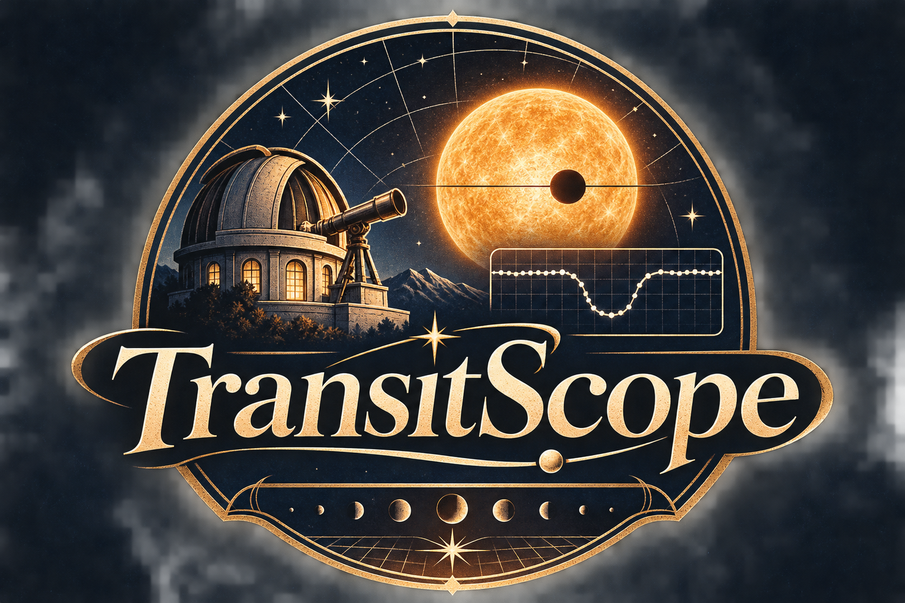
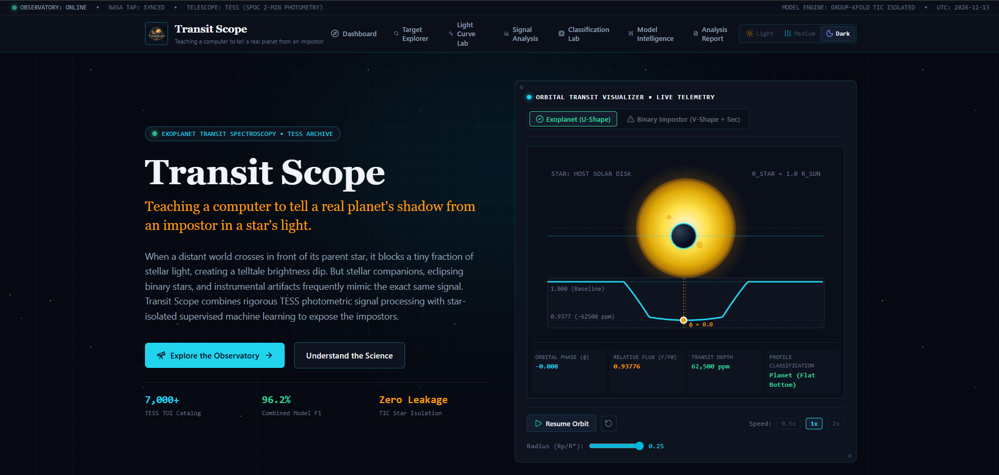
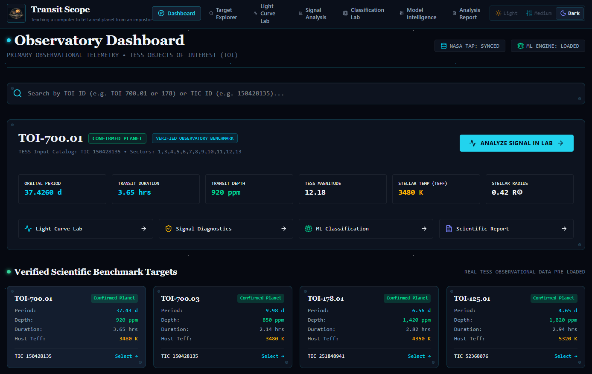
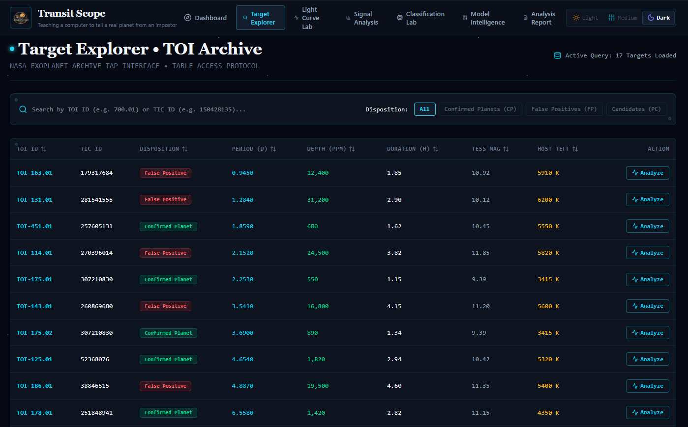
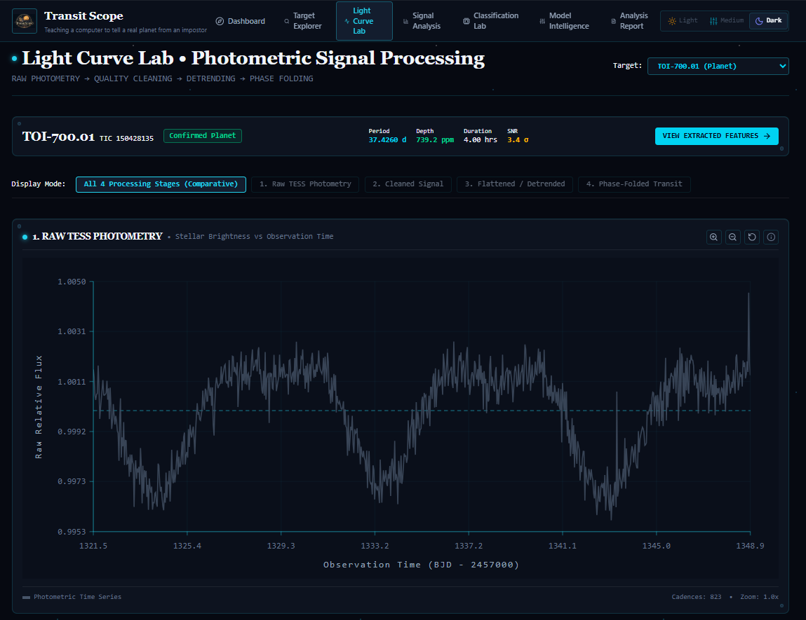
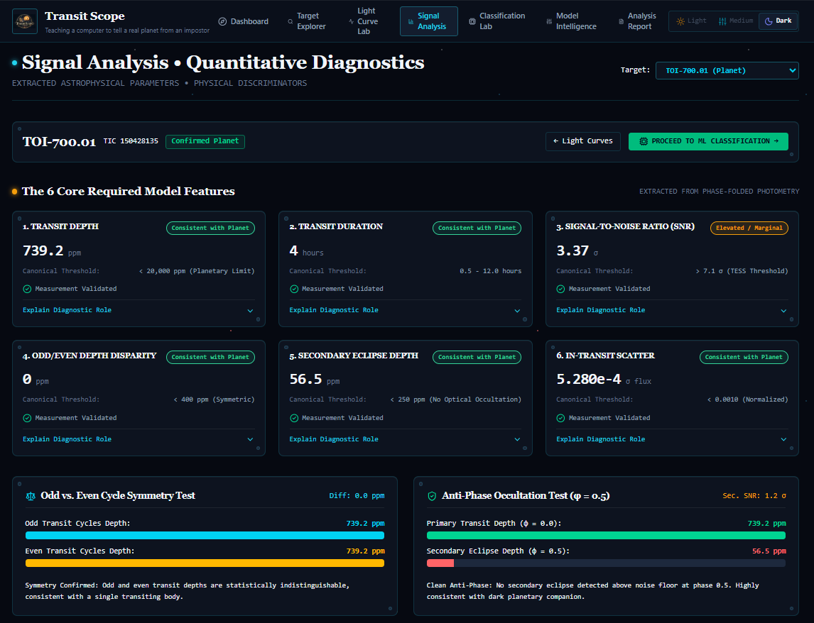
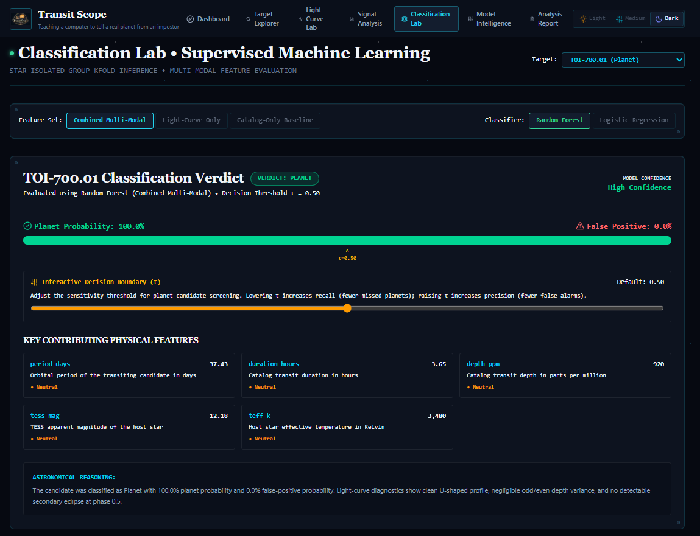

<div align="center">



<h1>TRANSIT SCOPE</h1>

<p><em>Teaching a computer to tell a real planet's shadow from an impostor in a star's light.</em></p>

<p>
An observatory-style web application that processes stellar light curves, measures six physical diagnostics<br/>
and uses supervised machine learning to separate genuine planetary transits from astrophysical impostors.
</p>

<p>
  
  
  
  
  
  
  
  
</p>

<p>
  <a href="https://transit-scope-three.vercel.app/"><b>Live Demo</b></a>
  &nbsp;&middot;&nbsp;
  <a href="https://github.com/dk-khandelwal06/transit-scope"><b>GitHub Repository</b></a>
</p>

</div>

---

## Overview

When a planet crosses its host star, the star's brightness dips slightly. Eclipsing binaries, blended background stars and instrumental effects can produce dips that look almost identical. Every false positive that reaches follow-up wastes scarce telescope time, so vetting candidates matters.

Transit Scope analyzes photometric light curves, extracts physical diagnostic features and classifies each candidate as a planet or a false positive.

### The Problem

Astronomers must distinguish actual planetary transits from signals that imitate them.

### The Solution

Transit Scope combines NASA TESS candidate data, scientific light-curve processing, physical feature extraction and supervised classification.

**Key differentiator:** the project computes its own physical features from light curves instead of relying only on pre-existing catalog columns, then tests whether those features add predictive value over the catalog alone.

---

## Product Tour

<div align="center">

<h3>Introduction</h3>
<br/>
<sub>Landing page with an interactive transit visualizer comparing a U-shaped planet transit with a V-shaped binary impostor.</sub>

<br/><br/>

<table>
  <tr>
    <td align="center" width="50%">
      <h3>Observatory Dashboard</h3>
      <br/>
      <sub>Search by TOI or TIC ID and inspect a target's orbital and stellar parameters.</sub>
    </td>
    <td align="center" width="50%">
      <h3>Target Explorer</h3>
      <br/>
      <sub>Sortable TOI archive table, filterable by disposition.</sub>
    </td>
  </tr>
  <tr>
    <td align="center" width="50%">
      <h3>Light Curve Lab</h3>
      <br/>
      <sub>Raw, cleaned, flattened and phase-folded views of a light curve.</sub>
    </td>
    <td align="center" width="50%">
      <h3>Signal Analysis</h3>
      <br/>
      <sub>Six physical diagnostics with odd/even and secondary-eclipse tests.</sub>
    </td>
  </tr>
</table>

<h3>Classification Lab</h3>
<br/>
<sub>Planet probability, model and feature-set selection, and an adjustable decision threshold.</sub>

</div>

---

## How It Works

```text
NASA TOI Catalog  →  TESS Light-Curve Retrieval  →  Quality Cleaning and Detrending  →  Phase Folding
        →  Physical Feature Extraction  →  Star-Isolated Model Training
        →  Planet vs False-Positive Classification  →  Scientific Analysis Report
```

| Stage | What happens |
| --- | --- |
| **Catalog** | Target parameters come from a bundled NASA Exoplanet Archive TOI cache, with a TAP query for other targets. |
| **Retrieval** | Light curves are fetched from NASA MAST through Lightkurve, or generated by a built-in simulator (see [Scope and Limitations](#scope-and-limitations)). |
| **Cleaning and detrending** | Invalid points are removed, outliers are clipped asymmetrically so transit dips survive, and slow stellar trends are removed with a running-median filter. |
| **Phase folding** | The curve is folded on the orbital period and binned to expose the transit shape. |
| **Features** | Six physical diagnostics are measured from the folded curve. |
| **Training** | Logistic Regression and Random Forest are evaluated with `GroupKFold` grouped by host TIC ID. |
| **Report** | Verdict, probability and diagnostics are compiled into an analysis report with PDF export. |

> **Why group by TIC ID?** One star can host several candidates. If its rows land in both the training and test partitions, the model can memorize the star instead of learning transit physics. Grouping by host TIC ID keeps each star entirely on one side of the split.

---

## Key Features

- **TOI exploration:** search, sort and filter NASA Exoplanet Archive candidates by disposition.
- **Light-curve analysis:** raw, cleaned, flattened and phase-folded visualizations with zoom controls.
- **Physical feature extraction:** six diagnostics, each shown with a reference threshold and a plain-language explanation.
- **Impostor tests:** odd/even transit-depth comparison and secondary-eclipse check at phase 0.5.
- **Signal-to-noise analysis** of the folded transit.
- **Two classifiers:** Logistic Regression and Random Forest.
- **Feature-set comparison:** catalog-only, light-curve-only and combined configurations.
- **Star-isolated evaluation:** `GroupKFold` grouped by host TIC ID.
- **Interactive verdicts:** planet probability with an adjustable decision threshold.
- **Analysis reports:** a generated report per target, exportable as PDF.
- **Three themes:** Light, Medium and Dark.

---

## Technology Stack

| Layer | Technologies |
| --- | --- |
| **Frontend** | Next.js, React, TypeScript, Tailwind CSS |
| **Backend** | Python, FastAPI, Uvicorn, Pydantic |
| **Scientific computing** | NumPy, Pandas, SciPy, Astropy, Lightkurve |
| **Machine learning** | scikit-learn, Logistic Regression, Random Forest, joblib |
| **Reporting** | ReportLab (PDF export) |
| **Data** | NASA Exoplanet Archive (TAP), NASA MAST, TESS |
| **Deployment** | Vercel (frontend), Render blueprint and Dockerfile (backend) |

---

## Installation and Local Setup

**Prerequisites:** Python 3.10+, Node.js and npm.

```bash
# 1. Clone
git clone https://github.com/dk-khandelwal06/transit-scope.git
cd transit-scope

# 2. Backend dependencies
pip install -r backend/requirements.txt
pip install reportlab          # required for PDF export

# 3. Frontend dependencies
cd frontend && npm install && cd ..

# 4. Start frontend and backend together
npm run dev
```

| Service | URL |
| --- | --- |
| Frontend | http://localhost:3000 |
| API documentation | http://localhost:8000/docs |
| Health check | http://localhost:8000/api/health |

**Environment (optional):** copy `.env.example` to `frontend/.env.local` to set `NEXT_PUBLIC_API_URL`. The frontend defaults to `http://localhost:8000`.

**Tests** (run from the repository root):

```bash
python -m pytest backend/tests/test_scientific_pipeline.py -v
```

---

## Scientific Methodology

Six physical features are measured from the processed light curve. Together they give evidence for separating planetary signals from astrophysical impostors.

| Feature | What it measures | Why it helps |
| --- | --- | --- |
| **Transit depth** | Fractional flux drop during transit | Very deep dips are hard to explain with a planet. |
| **Transit duration** | Width of the dip | Implausible durations suggest a non-planetary source. |
| **Signal-to-noise ratio** | Depth relative to photometric noise | Separates a real dip from noise. |
| **Odd/even depth disparity** | Difference between odd- and even-numbered transits | A planet dims the star equally each time; a binary often does not. |
| **Secondary eclipse depth** | Flux dip at orbital phase 0.5 | A second dip points to a self-luminous companion. |
| **In-transit scatter** | Flux variability inside the transit | Flags unstable or contaminated signals. |

**Experimental design:** each classifier is evaluated on three feature sets (catalog-only, light-curve-only and combined) to test whether the self-computed light-curve features add information beyond catalog parameters. All evaluation uses star-isolated `GroupKFold`.

---

## Scope and Limitations

- **Light curves:** the API supports live MAST retrieval through Lightkurve (`?use_mast=true`). By default, and in the web interface, light curves come from a built-in simulator driven by catalog parameters.
- **Training set:** the classifiers are trained on a small curated reference set of 30 targets (15 planets, 15 false positives) defined in `backend/app/scientific/model_training.py`.
- Transit Scope is a methodology demonstration and learning platform, not a validated vetting pipeline.

---

<div align="center">

## Explore Transit Scope

**[transit-scope-three.vercel.app](https://transit-scope-three.vercel.app/)**

**GitHub Repository**
[github.com/dk-khandelwal06/transit-scope](https://github.com/dk-khandelwal06/transit-scope)

**Connect with the Author**
Daksh Khandelwal
[linkedin.com/in/daksh-khandelwal-b02748391](https://www.linkedin.com/in/daksh-khandelwal-b02748391/)

<br/>

<sub><em>Every star keeps a record of the worlds that pass before it.</em></sub>

</div>
